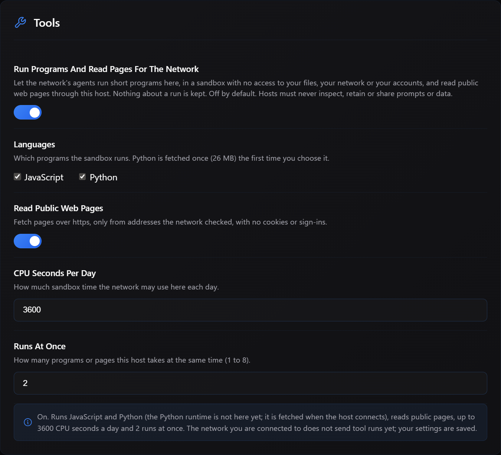
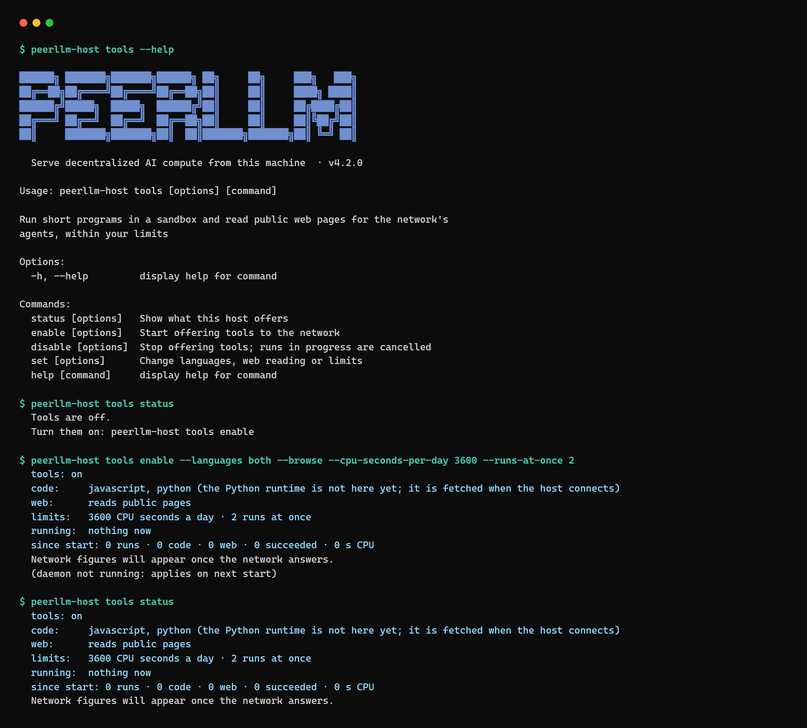
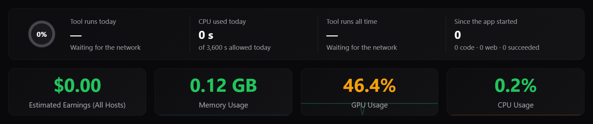
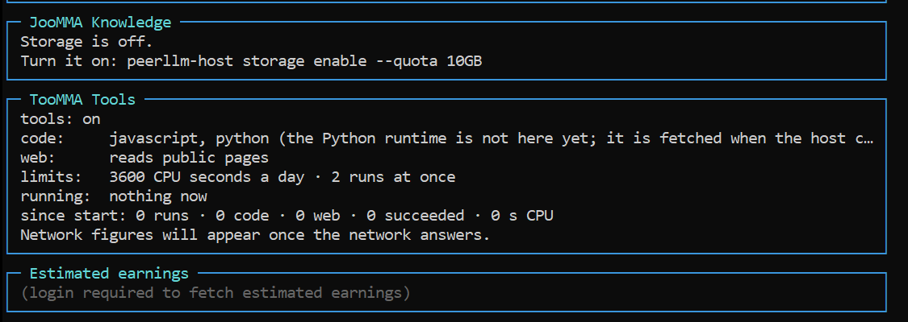

Before there were factories, there was work in the home. A family spun thread at the kitchen table, a neighbor wove it, and a merchant came around to collect and pay. Then the mill arrived, and work moved under one roof, because the water wheel that powered it could not be split and carried to a thousand houses. For a long stretch of history the shape of work was decided not by where the people were, but by where the power was.

Artificial intelligence is at its mill stage. The models that answer most of the world's questions run in a small number of very large buildings, owned by a few companies, placed wherever power, land and water can still be found in quantity. That arrangement has two problems, and I think about both of them every day. The first is physical. Demand for intelligence is growing faster than anyone can fabricate the chips, pour the concrete, string the transmission lines or find the water to cool the racks, and the buildings cannot practically expand at the rate the demand does. The chips alone are a bottleneck the whole industry is queuing behind. The second is human, and it is the bigger one. The people driving centralized AI do not have an answer for the millions who will be displaced by it. They have a schedule for the models and no plan for the people.

PeerLLM is my attempt to answer both. It is a network of individuals' computers that serve models, hold data and now run tools, and that pay their owners for the work. Host 4.2.0, out now for both the desktop app and the command-line host, is the release where that idea becomes complete. It is the first release since 3.2.0, and it is the biggest one I have shipped.

The thesis is this: anyone, with fancy GPUs or without them, should be able to join the network and make money out of it, because every resource a machine has is worth something to someone. I call that resource *Idle Capital*: the storage, memory, CPU, GPU and network connection sitting in a home or an office, switched on and mostly unused, that could be earning its owner a share of the intelligence economy instead. Storage counts. RAM counts. CPU counts. A GPU counts, but it is no longer the ticket in. Even a network connection that can fetch a web page has value. The goal of PeerLLM is to let individuals be part of the AI evolution, which benefits the whole of humanity, without anyone having to build a massive data center, and without the future staying monopolized by the few who can.

A network like that only works if strangers can be paid for work nobody watched them do. So this release carries two things. It carries tools, which let a machine without a GPU earn, and it carries verification, which lets the network prove that every machine is honest without reading a single conversation. If you run a host, here is what is new, what it means for you, and what you need to do.

## 0/ Every Machine Counts

Think of a house with solar panels on the roof. For a century a house only consumed electricity, and the grid was something done to it. Panels turned the house into a producer. It still uses power, but on a bright afternoon it sells the surplus back, and the grid gets stronger with every roof that joins. Nobody asked the homeowner to build a power plant. They asked for the roof they already had.

PeerLLM has been working toward that shape since the first host came online, one resource at a time. A host with the memory and the graphics card to run a model could serve inference, and a host with spare disk could hold the network's data and be paid for the space. But a machine with a good CPU and no GPU could store and not much else, and a laptop on a fast connection had nothing to offer at all. Host 4.2.0 adds the piece that was missing. The network calls it TooMMA, the tools pillar that stands next to JooMMA, which holds the data, and LLooMA, which serves the models. With TooMMA, every resource a machine has is work the network can send to it. A GPU serves a model. A CPU runs code. A network connection reads the web. Storage holds the data all of it depends on.

That is what I mean when I say this release completes the network's ability to let anyone participate. The roof was always there. Now there is a way to connect it.

## 1/ Borrowed Hands

A model alone cannot answer many of the questions people ask: a calculation, a quick script, today's news, a page someone linked. Host 4.2.0 adds the first two network tools. Think of it as the model borrowing a pair of hands from your machine for a few seconds, under rules you wrote.

The first hand runs code. A host can execute small JavaScript or Python programs inside a WebAssembly sandbox with no network and no file system, under a wall-clock limit, a memory limit and an output size limit. The host reports the result and a hash of it, and the network runs important jobs on two hosts and compares the two. The second hand browses. A host can fetch one web page at a time and turn it into text for the model. It connects only to the addresses the network resolved and pinned for that page, follows at most a handful of redirects, and checks every one of them against the same list. Searching the web is not done on hosts. The network uses a sanctioned search provider for the search itself, and hosts read the pages the search turns up.

Both hands are off until you turn them on. In the desktop app there is a new Tools section in Settings. You choose whether tools are on at all, which languages you allow, whether browsing is allowed, how many CPU seconds per day you give the network, and how many runs may happen at once. Python support downloads a small runtime the first time you enable it. Turning tools off takes effect at once.



In the command-line host the same choices are one command:

```
peerllm-host tools enable --languages both --browse --cpu-seconds-per-day 3600 --runs-at-once 2
```

and `peerllm-host tools status` shows where you stand.



You can also see everything your host did. The host dashboard has a new TooMMA Tools panel with code runs, browse runs and CPU time. The hosts portal shows tool runs on each request's flow, and a Tool Runs page lists every run with its outcome. The network observatory shows tool traffic next to inference and data. The network stores only ids, hashes and outcomes for a run, never the program, the page or the output.





Payouts for tool runs are coming, but they are not live yet. Tool work will be paid the same way inference is, by tokens in and tokens out, with no separate CPU rate. The ledger that makes that possible ships in this release. The payout switch stays off until the accounting has run alongside live traffic for a while, and I will announce when it turns on. When it does, a machine that never had a graphics card will earn from the same network, by the same rules, as one that does.

## 2/ The Hallmark

Idle Capital has a catch, and it is the same catch every market of strangers has. A caller sends a prompt to a machine they will never see, run by a person they will never meet, and gets an answer back. Until now the network had to take that host at its word: that it ran the software it downloaded, and that it served the model it registered. Nobody pays a stranger for long on their word alone. If a network of spare resources is going to pay its owners, it has to be able to prove, without reading anyone's conversation, that each of them did the work they are being paid for.

Silver solved this centuries ago. A buyer cannot tell sterling from a convincing alloy by looking, so assay offices took a sliver from each piece, tested it, and struck a hallmark into the metal. The hallmark did not make the silversmith honest. It made honesty visible, and it made dishonesty expensive, because a piece without the mark was worth less than the metal in it. Host 4.2.0 is the release where the network stops taking anyone's word and starts striking marks.

The network calls the result Proof of Honesty: four checks and one receipt, applied to every host on 4.2.0. The first is the software check. Every release now ships with a manifest listing every file in the install and its hash. When your host connects, and again every few hours, the network asks it to hash a selection of those files and compares the answers to the manifest. A modified install is flagged. The second is the model-file check, which is the assay office taking its sliver. The network asks your host for keyed hashes over random byte ranges of a model file and compares them with the same ranges of the original file at the model's upstream source. A swapped, truncated or quantised-down model is flagged.

The third is the answer audit. A small sample of the answers your host produces are re-scored, token by token, on a reference host running the same model. Your host signs a receipt for each audited answer with a key created on your machine on first run, and those receipts are what let the network settle a dispute later. The fourth is the identity check. As part of the regular compliance rounds, the network sends your host fresh prompts and compares the output with a trusted host serving the same model. A host that announces one model and runs another will not match.

Hosts that pass are marked as certified on the hosts portal, on a new Integrity page that shows the result of each check for each host. That badge is the hallmark: not a promise from the host, but a mark struck by the network after it looked. If something is flagged on your host, the page says what and why. Flags on a host hold its payouts for the affected work once the forfeit rules are switched on; that switch is also coming later, and I will say so when it does. None of these checks reads your prompts or your users' conversations. They look at files on disk and at model output for prompts the network chose. The checks exist so that the payments can.

## 3/ Measure First

Models have a fixed amount of text they can hold at once. Before this release, a prompt that did not fit could produce an answer built on a cut-off prompt, or a crash on the host. In 4.2.0 the host measures the prompt before generating the first token. If it fits, generation starts. If the model can take a larger window, the host grows it, up to what the model was trained for. If the prompt still does not fit, the host tells the network, which reroutes the request to a host that can take it or falls back. Your host no longer wastes time on a prompt it cannot answer well.

The same release fixes a quieter waste. A cancellation that arrived while a model was still loading used to be lost, and the host would run the whole prompt for a caller who had already gone. That cancel is now remembered and honored. Both fixes matter more on a network of ordinary machines than they would in a data center, because every wasted minute on a host is a minute its owner is not being paid for.

## 4/ Standing Still

If you stay on an older version, nothing breaks. Hosts below 4.2.0 keep serving inference and storage exactly as before. They are not asked to run tools, they are not sent integrity challenges or audits, and their payouts are not affected by any of the new checks. The identity check applies to every version, because it only compares model output, and a host that serves the model it claims has nothing to worry about.

What you miss is the new work and the mark that comes with it: no tool runs, no certified badge, and no tool-run payouts when those start. And standing still is not a place you can stay. The network will raise its minimum version over the coming releases, and hosts that remain below it will stop receiving traffic altogether. I will announce the date before it arrives, and there will be time to move. I recommend upgrading now, while the only cost of waiting is the work you are not being paid for.

## 5/ Moving Up

For the desktop app, sign in to the hosts portal and open the Downloads page at https://hosts.peerllm.com/downloads. Pick the 4.2.0 installer for your platform and run it over your current install. Your settings, your models and your storage stay where they are. For the command-line host, run:

```
npm install -g peerllm-host-cli@4.2.0
```

then restart the host. If you run it as a service, restart the service. On first start after the upgrade, the host creates a receipt-signing key in its data folder. Keep it with the rest of your host data; the desktop app and the command-line host share it on the same machine.

After you upgrade, open the hosts portal. Within a minute or two of connecting you should see your host's software check pass on the Integrity page. Model-file checks follow within a few hours. If you want to offer tools, turn them on in Settings and watch the first runs land on the dashboard.

## 6/ The Future

The mill did not last forever. Electricity arrived, the motor got small enough to carry, and work that had been gathered under one roof spread back out to wherever people happened to be. I believe intelligence will follow the same arc, and I would rather help it along than wait for it. Every machine that joins the network is one more roof producing instead of only consuming, one less reason to pave another field for a data center, and one more person with a stake in the thing that is about to change their work.

With 4.2.0 the network stands on three pillars. JooMMA holds the data. LLooMA makes the decisions, which is what a model does when it answers. TooMMA gives direction: it acts, running code and reading the web, so that a decision can become something done. Where I want to go next is decentralized AI agents living on top of all three. An agent is a program that is given a goal rather than a question, and that takes the steps to reach it: it reads what it needs from the data, decides with the model, acts with the tools, and keeps going until the work is finished. That is not a loose description. It is the definition at the heart of The Standard Agent, the open source standard for building agents as an orchestration of three natures, data, decision and direction. PeerLLM's pillars are those three natures laid out across a network, so the agents that run on it will be Standard agents, built in the open, with the network as their runtime. All of it is public: the [specification](https://github.com/hassanhabib/The-Standard-Agent-Specs), and the implementations in [C#](https://github.com/hassanhabib/The-Standard-Agent), [TypeScript](https://github.com/hassanhabib/standard-agents) and [Python](https://github.com/hassanhabib/The-Standard-Agent-Python). What you see there is what everyone gets, and if you like to code, you are welcome to contribute to that effort. Most of the agents being built today run in the same few buildings as the models and answer to the companies that own them. I want agents that run across the machines of the people they serve, that pay the owners of those machines for every step, and that answer to the person who asked. Decentralized agents supporting the rest of us, not just the few. That is a plan, not a release, and I am saying it out loud so you can hold me to it.

The second plan concerns what those agents, and the models beneath them, are allowed to know. A model today is trained on whatever could be gathered, and the result is a mind full of facts with no provenance: the author stripped away, the source forgotten, data of unknown origin baked in where nobody can inspect it or correct it. I intend to collect open data sets, verified and trusted, hold them on the network, and let answers come only from those sources. Verified means someone checked the data against where it came from. Trusted means the network knows who published it and keeps their name attached. Available means it lives on the hosts, in JooMMA, where it cannot quietly vanish because a license changed or a company closed its doors. An answer from a known source with a known author is one a person can check, cite and credit. An answer pulled from the fog of a training set is one a person can only believe.

Neither of these has shipped, and I am careful to say so. What has shipped is the ground they will stand on. A person displaced by AI is not helped by a faster model. They are helped by owning a piece of the machinery that replaced them, and by being paid when it runs. Host 4.2.0 is the release where that piece can be a CPU, a hard drive or a network connection, and where the network can prove the piece did its job. Keep asking hard questions about who this is for. The answers end up in releases like this one.

---

**Hassan**
